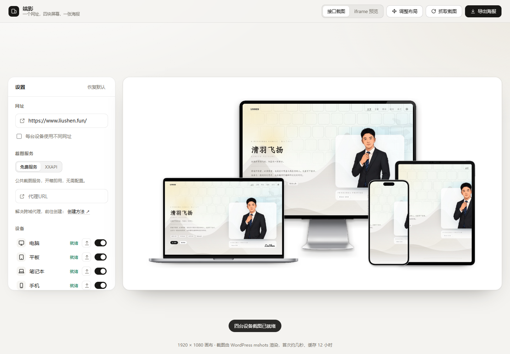

# 端影 · Multi-device poster

[在线示例](https://prtsc.liushen.fun) | [个人主页](https://www.liushen.fun)

把一个网址分别放进电脑、笔记本、平板和手机的屏幕里，叠成一张展示海报（默认 **1920 × 1080**，比例可换成 1:1、3:4、9:16 等任意值）：电脑居中靠后、平板右侧、笔记本左前、手机最前，每台设备都带一层柔和投影，导出 PNG 就能当网站对外的门面图。



## 两种模式

| 模式 | 原理 | 导出 |
| --- | --- | --- |
| **接口截图** | 由 WordPress mshots 服务端渲染出真实截图，再用 Canvas 合成到画布（默认 16:9） | 支持一键导出（1× / 2×） |
| **iframe 预览** | 按各国设备视口尺寸实时嵌入目标站点，同样叠放 | 不支持（跨域文档无法绘制到 Canvas） |

接口模式是默认模式，也是唯一能导出的模式；iframe 模式用来快速确认「目标站点在这四种视口下长什么样」。

### 为什么 iframe 不能导出

`iframe` 属于跨域文档，把它画进 `canvas` 会污染画布，`toBlob()` 直接抛异常；此外大量站点用 `X-Frame-Options` 或 CSP `frame-ancestors` 拒绝被嵌入，页面会空白。所以导出只能走服务端截图这条链路。

### 跨域（CORS）怎么办

前端没有任何办法关掉同源策略：`fetch` 读不到对方的 `Access-Control-Allow-Origin`，`` 能显示但画进 canvas 会污染，`mode: 'no-cors'` 拿到的是读不了的透明响应。可选的只有三条路：

1. 用本身带 CORS 头的截图服务 —— 本项目的 mshots / thum.io / XXAPI 返回的图片都带 `Access-Control-Allow-Origin: *`，可以直接合成导出。
2. 加一层反向代理（Cloudflare Worker / nginx），由代理补上 CORS 头；代码里保留了这条路（`settings.proxy` 填一个前缀即可把所有抓取请求转发过去），界面上没做开关，需要时自己在 `defaultSettings()` 里配。
3. 服务端代抓，也就是回到方案 1。

踩过的坑：XXAPI 的 `return=302` 跳转在浏览器里会被 CORS 拦掉（`Failed to fetch`），必须用 `return=json` 拿到图片地址再取一次。

## 功能

- **一次四端**：电脑 1280×840、平板 720×960、笔记本 1280×805、手机 390×844，四个视口分别抓取，得到真实的响应式布局，不是把一张图缩放四次。
- **真实截图**：默认用免费服务，优先 WordPress mshots（`s0.wp.com/mshots/v1/`），失败自动回落到 thum.io；两者都返回 `Access-Control-Allow-Origin: *`，因此可以导出。
- **自带密钥的截图服务**：设置里可把「截图服务」切到 XXAPI（`v2.xxapi.cn`），密钥填在面板的输入框里，只存本机 localStorage，不进代码、不进仓库。调用走 `return=json`（`return=302` 的跳转在浏览器里会被 CORS 拦掉），拿到返回的图片地址再取成 Blob 合成；`width` 传设备视口宽，保证拿到对应端的响应式版式。
- **画布比例可调**：设计坐标只有一条规则 —— 画布宽恒为 1920，高度由比例算出来（16:9 → 1080、1:1 → 1920、9:16 → 3413）。面板里既有 16:9 / 4:3 / 1:1 / 3:4 / 9:16 快捷按钮，也能直接手填任意两个数字；比例夹在 1:4–4:1 之间，免得导出几千万像素的位图。换比例时设备按画布中线整体平移，构图疏密不会散。
- **拖动改布局**：点顶栏的「调整布局」，四台设备会浮出可拖拽的虚线框，画布范围里随便拖，贴边也不会被切掉（边界按设备本体算，不含底图自带的透明边）；选中后用方向键微调，按住 Shift 走 10 像素。位置存本机 localStorage，刷新后还在，点「恢复默认」即可回到 `devices.ts` 里的原构图。编辑状态下画布内部不叠加任何控件，iframe 模式下可以直接对画布截图。
- **设备边框自带投影**：投影烘焙在 PNG 里（半透明黑、三层模糊），不依赖 CSS 或 Canvas 阴影，因此任何画布底色下都不会出现白边、硬矩形。
- **超采样合成**：设备边框按 2 倍超采样绘制，导出 2× 时为 3840×2160，屏幕内容不糊。
- **导出选项**：画布比例、画布底色（纸白 / 暖白 / 浅灰 / 墨黑 / 透明 / 自定义）、画面适配（填充裁切或完整留白）、倍率 1× / 2×。导出裁剪的就是整块画布，和预览里看到的构图一致。
- **兜底上传**：个别站点拒绝被抓取时，可在设置里为某台设备上传自己的截图，合成与导出照常。
- **未抓取也有画面**：还没抓取 / 抓取中 / 抓取失败时，设备屏幕里会先画一张灰阶网页骨架，四台设备的位置、比例和投影都能立刻看到，不会只是一片空白。
- **每台不同网址**：一键切换后，四台设备可以分别指向不同页面（例如 PC 版首页 + 移动版落地页）。
- **本地记忆**：网址、开关、底色、适配、倍率与拖动过的设备位置都保存在 localStorage。
- **移动端**：窄屏下面板改为底部抽屉，操作收进悬浮 dock。

## 界面

- **顶栏**：左上站点标识，右侧是「接口截图 / iframe 预览」切换和「抓取截图 / 导出海报」。
- **左栏**：标题固定，下面的设置项自己滚动 —— 内容再多也只在卡片内部滚动，不会把左侧卡片顶高、带着右侧舞台一起变形。
- **右栏**：卡片本身就是画布 —— 按当前比例取尽可能大的尺寸铺在可用空间里（横向、纵向、方形都行），左栏高度跟着画布走；窗口再小也只是整体缩小，不会裁掉设备。
- **卡片下方**：状态条。接口模式显示画布尺寸与抓取来源；iframe 模式显示绿点 +「实时预览」。这个角标刻意放在卡片外面，卡片里保持干净，导出时不会带进图里。
- **窄屏（≤1023px）**：左栏变成底部抽屉，主要操作收进悬浮 dock，画布铺满宽度。

## 合成方案

1. **抓取**：四台设备各按自己的视口（电脑 1280×840、平板 720×960、笔记本 1280×805、手机 390×844）分别向截图服务要图，拿到的是真实的响应式排版，而不是把一张图缩放四次。
2. **画框**：`src/assets/images/new-model/` 里的设备边框 PNG，屏幕区域是透明的。合成时先按 `screen` 矩形把截图画进去（「填充」按封面裁切、「完整」留白居中），再把整张边框盖在上层，边缘、刘海、摄像头这些小细节都在图里。
3. **投影**：投影不是 CSS `box-shadow` / Canvas `shadowBlur`，而是**烘焙进 PNG 本身**的半透明黑（三层模糊 + 底部偏移）。所以换底色永远成立：纸白上是淡淡的灰影，墨黑上不会冒出白边或硬矩形。同时把原素材底部自带的白色倒影、硬阴影整个去掉了。
4. **舞台**：`poster` 字段是每台设备在设计坐标里的矩形和层级（电脑 0 → 平板 1 → 笔记本 2 → 手机 3），画布宽固定 1920、高随比例变化，`PosterStage.vue` 只做一次 `scale` 换算，预览与导出共用同一套坐标，所见即所得。
5. **导出**：设备边框按 2 倍超采样重绘，导出倍率选 2× 时输出 3840×2160；屏幕内的截图会按矩形重新采样，不会被边框拉伸。

## 使用

1. 在「网址」里输入域名（`https://` 可省略），点「抓取截图」。
2. 首次抓取通常几秒到十几秒，画布下方会显示进度；同站点 12 小时内命中 mshots 缓存，基本 1–2 秒出图。
3. 切换底色 / 适配 / 倍率，画布实时更新。
4. 点「导出海报」下载 PNG；想实时看页面本身，切到「iframe 预览」。
5. 想用自带密钥的 XXAPI：设置里「截图服务」选 XXAPI，把控制面板里的 Access Key 粘进输入框即可；密钥只会写进本机浏览器。

## 开发

```bash
npm install
npm run dev      # 本地开发（默认 http://localhost:5173）
npm run build    # vue-tsc 类型检查 + 生产构建
npm run preview  # 预览构建产物
```

技术栈：Vue 3 + TypeScript + Vite，无 UI 框架，样式为手写 CSS。

## 目录结构

```
src/
├─ App.vue                 # 页面结构、抓取队列、导出、设置持久化、响应式布局
├─ components/
│  ├─ PosterStage.vue      # 画布舞台：Canvas 合成 / 叠放 iframe
│  ├─ SettingsPanel.vue    # 网址、设备开关与上传、底色、适配、倍率
│  └─ Icon.vue             # 内联 SVG 图标集
├─ lib/
│  ├─ devices.ts           # 四种设备的边框尺寸、屏幕区域、抓取视口、海报坐标与图层顺序
│  ├─ poster.ts            # 叠放合成、屏幕填充、导出 Blob 与下载（投影已烘进边框图）
│  ├─ screenshot.ts        # mshots / thum.io 请求、轮询与回落，以及 XXAPI 密钥调用
│  └─ settings.ts          # 设置模型与 localStorage 读写
├─ assets/images/new-model # 设备边框 PNG（屏幕区域透明、自带烘焙投影、四周留白）
└─ style.css               # 全局变量与基础样式
```

## 已知限制

- 抓取依赖第三方服务（WordPress mshots / thum.io），需要联网；服务端视角的页面与登录后状态不同，需要登录的页面抓不到。
- mshots 单张上限 1280×960，所以桌面端按 1280 宽抓取后再放大到画布；要更高清的桌面截图可以改用 thum.io 的 `outputWidth`。
- 少数站点会拒绝被抓取，此时用「上传」按钮手动补图。
- XXAPI 有并发限制，同时发四个请求会回「请求过于频繁」，所以走 XXAPI 时只并发两台并错开起跑；另外它返回的是整页长图，「填充」模式只取页面顶部那段。
- iframe 模式对设置了 `X-Frame-Options` / CSP 的站点会显示空白，这是浏览器安全策略，无法绕过。
- 替换设备素材时要一起改 `devices.ts`：`frameSize` 是整张 PNG 的尺寸（含四周投影留白），`screen` 是透明屏幕区的矩形，两者都以 PNG 像素为单位。

## 致谢

最初版本参考 [himkiong/multiterminal-preview](https://github.com/himkiong/multiterminal-preview)，现已重写为「服务端截图 + Canvas 叠放合成」的方案。

欢迎提交 Issue 和 PR。
